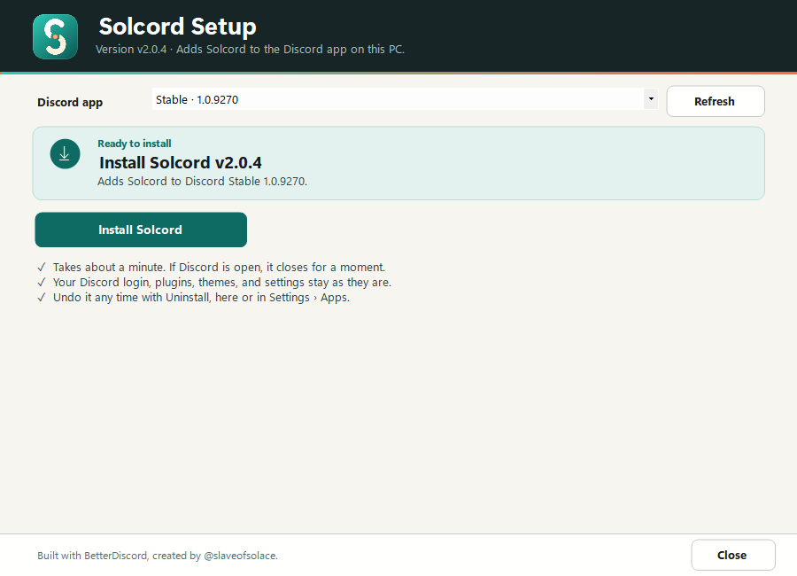
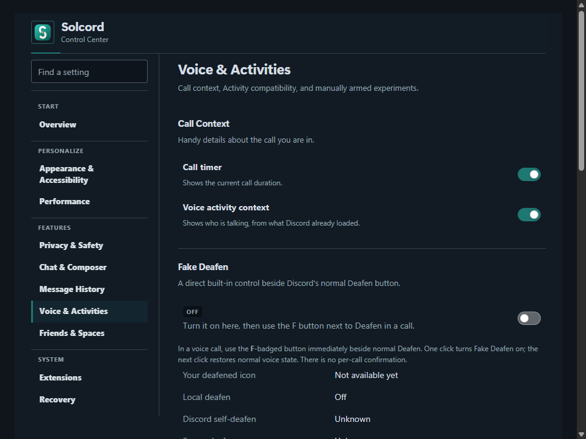
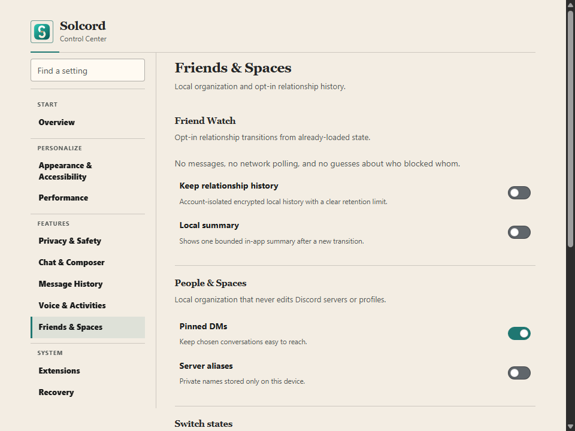
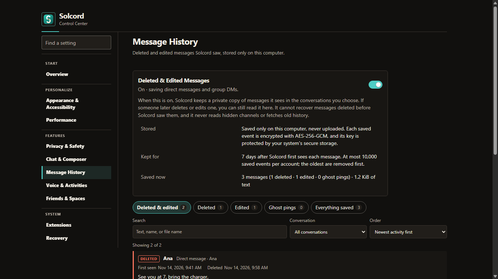

<div align="center">


# Solcord

**Discord, your way: themes, privacy controls, Message History, and a settings panel that explains itself.**

[](https://github.com/celubos/Solcord/releases/latest)
[](https://github.com/celubos/Solcord/releases)
[](https://github.com/celubos/Solcord/actions/workflows/solcord-ci.yml)
[](LICENSE)


### [⬇ Download Solcord for Windows](https://github.com/celubos/Solcord/releases/latest/download/SolcordInstaller.exe)

[Quick start](docs/QUICK_START.md) · [User guide](docs/USER_GUIDE.md) · [Privacy](docs/SECURITY_AND_PRIVACY.md) · [Mac preview](docs/MACOS.md) · [Get help](SUPPORT.md)

</div>

---

## Install in three steps

1. **Download** [SolcordInstaller.exe](https://github.com/celubos/Solcord/releases/latest/download/SolcordInstaller.exe).
2. **Open it and choose Install Solcord.** If Discord is open, Setup asks before closing it for a moment.
3. **Open Discord.** In **User Settings**, scroll to the bottom of the list and choose **Open Solcord Suite**.

That's it. Your Discord login, plugins, themes, and settings stay as they are. You need Windows x64 and the normal Discord desktop app; nothing else to install.

<p align="center"></p>

> [!NOTE]
> Solcord isn't code-signed yet, so Windows SmartScreen may say it doesn't recognize the app. If you downloaded it from this page, choose **More info**, then **Run anyway**. Never turn off Windows security to install anything. You can [check the download](docs/QUICK_START.md#check-the-download) against the published checksum.

After installing you'll find two things in the Start menu:

- **Solcord** opens Discord. If a Discord update ever switched Solcord off, it turns it back on first.
- **Solcord Setup** updates, repairs, or removes Solcord. It's also listed in **Settings → Apps → Installed apps**.

## What you get

<p align="center">
  
  
</p>

| | |
| --- | --- |
| **Appearance** | Eleven full themes, animated backgrounds, density, accent colours, and reduced motion |
| **Message History** | Read messages that were deleted or edited after you saw them. Off until you turn it on, encrypted, and kept only on your PC |
| **Privacy** | Strict Privacy blocks Discord's optional tracking, plus link checks, file checks before upload, and screen-share protection |
| **Chat** | Character count, timestamps, reply shortcuts, long-message splitting, and a media shelf |
| **Voice** | Call timer, volume controls, voice notes, connection checks, and Fake Deafen |
| **Friends & servers** | Pinned DMs, private server nicknames, hidden servers, and focus channels |
| **Peace of mind** | Plugin Doctor, add-on quarantine, settings snapshots, and one-click repair or undo in Setup |

Everything lives in one place: **User Settings → Open Solcord Suite**. Use its search box to find any setting.

<p align="center"></p>

## Updates

Solcord keeps working when Discord updates itself. If it ever looks switched off, open Discord from the **Solcord** Start menu entry, or open **Solcord Setup** and choose **Turn Solcord back on**.

To get a new version of Solcord, download the latest installer and choose **Update Solcord**. Your settings come along, and you can roll back if you need to.

## Remove Solcord

Open **Settings → Apps → Installed apps**, find **Solcord**, and choose **Uninstall** (or use **Uninstall** in Solcord Setup). Discord goes back to normal. Your plugins, themes, and settings stay on your PC in case you come back; to also delete saved messages, choose **Erase history** in Message History first.

## Privacy, in plain words

- Everything private (Message History, notes, nicknames) is **off until you turn it on** and stays **on your computer**.
- Strict Privacy turns off Discord's optional analytics and crash reports. Messages, voice, and login still go to Discord as normal.
- Solcord can't read hidden channels, recover messages from before it was installed, or make Discord end-to-end encrypted.

[Privacy guide](docs/SECURITY_AND_PRIVACY.md) · [Audience Guard](docs/STREAM_AUDIENCE_GUARD.md) · [Report a security issue](SECURITY.md)

## Help

| Problem | Fix |
| --- | --- |
| Setup says **Solcord is off** | Choose **Turn Solcord back on**. |
| Setup says **Newer version installed** | You opened an old installer. Use **Solcord Setup** from the Start menu. |
| Something looks broken after a change | Open **Solcord Setup** and choose **Roll back**. |
| Setup can't close Discord | Quit Discord from the system tray (near the clock), then try again. |

More answers are in the [quick start](docs/QUICK_START.md#if-something-goes-wrong) and [support guide](SUPPORT.md).

## For developers

You need Git and **Bun 1.4.0**; building the Windows installer also needs the **.NET 8 SDK**.

```sh
git clone https://github.com/celubos/Solcord.git
cd Solcord
bun install --frozen-lockfile
bun run verify
bun run build
```

See [Contributing](CONTRIBUTING.md) for tests, layout, and release checks, and the [documentation index](docs/README.md) for everything else. [Release status](docs/STATUS.md) lists what each version was checked against.

## License and credit

Solcord is maintained by [@celubos](https://github.com/celubos) and built on [BetterDiscord](https://github.com/BetterDiscord/BetterDiscord), whose history, contributors, Apache-2.0 license, `BdApi`, and add-on compatibility are kept. It's an independent project, not affiliated with Discord or BetterDiscord. See [LICENSE](LICENSE), [NOTICE](NOTICE), and the [provenance registry](docs/PROVENANCE_REGISTRY.md).
