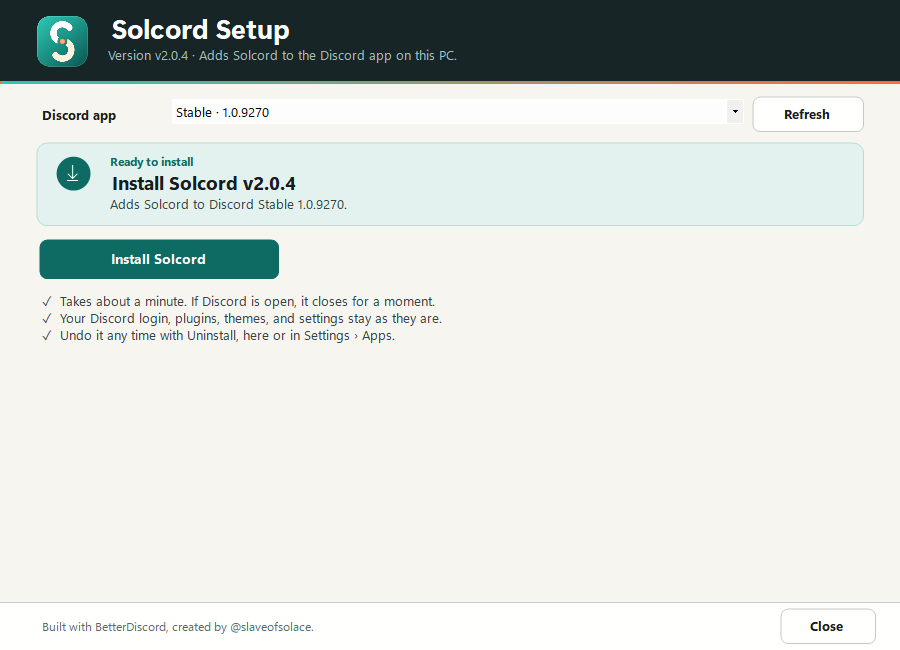

# Solcord quick start

Getting Solcord running takes about a minute. You need Windows x64 and the normal Discord desktop app (open it once first so it finishes installing). On a Mac, read the [macOS preview guide](MACOS.md) instead.

## 1. Download

Download **[SolcordInstaller.exe](https://github.com/celubos/Solcord/releases/latest/download/SolcordInstaller.exe)** from the latest release.

Solcord isn't code-signed yet, so Windows SmartScreen may say it doesn't recognize the app. If you downloaded it from the link above, choose **More info**, then **Run anyway**. Never turn off Windows security to install anything.

<details>
<summary><strong>Check the download (optional)</strong></summary>

### Check the download

Download **[SHA256SUMS.txt](https://github.com/celubos/Solcord/releases/latest/download/SHA256SUMS.txt)** into the same folder, open PowerShell there, and run:

```powershell
Get-FileHash .\SolcordInstaller.exe -Algorithm SHA256
```

The result must match the `SolcordInstaller.exe` line in **SHA256SUMS.txt**. If it doesn't, delete the file and don't run it. **RELEASE-SHA256SUMS.txt** on the release page covers every Windows and Mac file.

</details>

## 2. Install

Open **SolcordInstaller.exe** and choose **Install Solcord**.



- If Discord is open, Setup asks before closing it for a moment. Save drafts and leave calls first.
- Setup finds your Discord by itself. If you use PTB or Canary, pick it under **Discord app**.
- When it says **Solcord is on**, choose **Open Discord**.

Setup keeps a copy of itself, so you can delete the download. From now on:

- **Solcord** in the Start menu opens Discord, and turns Solcord back on first if a Discord update switched it off.
- **Solcord Setup** in the Start menu (and in **Settings → Apps → Installed apps**) updates, repairs, or removes Solcord.

## 3. Open the settings

In Discord, open **User Settings**, scroll to the bottom of the list, and choose **Open Solcord Suite**.

The first time, a short setup walks you through privacy, appearance, and features. Nothing changes until you choose **Apply**, and **Finish later** keeps your place. You can reopen it any time from **Recovery → First Setup**.

A good start: pick a theme, leave Message History and other private features off until you want them, and try one feature at a time.

## Updating

Solcord keeps working when Discord updates itself, so normally there's nothing to do.

For a new version of Solcord, download the latest installer and choose **Update Solcord**. Your settings come along, and **Roll back** in Solcord Setup undoes the update if you need to.

## If something goes wrong

| What you see | What to do |
| --- | --- |
| Setup says **Solcord is off** | Discord updated without Solcord. Choose **Turn Solcord back on**. |
| Solcord disappeared after a Discord update | Open Discord from the **Solcord** Start menu entry, or open **Solcord Setup** and choose **Turn Solcord back on**. |
| Setup says **Newer version installed** | You opened an old installer. Use **Solcord Setup** from the Start menu, or download the latest one. |
| Setup can't close Discord | Quit Discord from the system tray (next to the clock), then try again. |
| Your Discord isn't listed | Open Discord once, quit it, then choose **Refresh** in Setup. |
| Something broke after a change | Open **Solcord Setup** and choose **Roll back**. |
| Files are missing or damaged | Open **Solcord Setup** and choose **Repair**. |
| Setup shows an error | Choose **Error details** to read the full message. Nothing is sent anywhere. |
| A feature says **Unavailable** | Discord changed something that feature needs. Check **Recovery → Plugin Doctor**. |
| A background isn't moving | In **Appearance**, pick a background instead of Signal or Off, and check that reduced motion is off. |

Setup's **Backups** row opens the folder with the backup it makes before every change. Please don't delete `%APPDATA%\BetterDiscord` to fix problems; it holds your plugins, themes, and settings.

## Removing Solcord

Open **Settings → Apps → Installed apps**, find **Solcord**, and choose **Uninstall** (or use **Uninstall** in Solcord Setup). Discord goes back to normal, and the Start menu entries are removed.

Your plugins, themes, settings, and backups stay on your PC in case you come back. To also delete saved messages, choose **Erase history** in **Message History** before uninstalling.

More detail on backups and recovery: [Install and rollback](INSTALL_AND_ROLLBACK.md).
